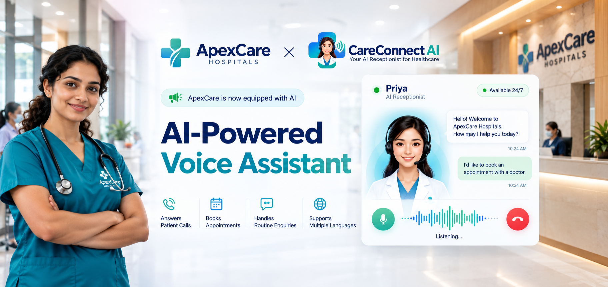
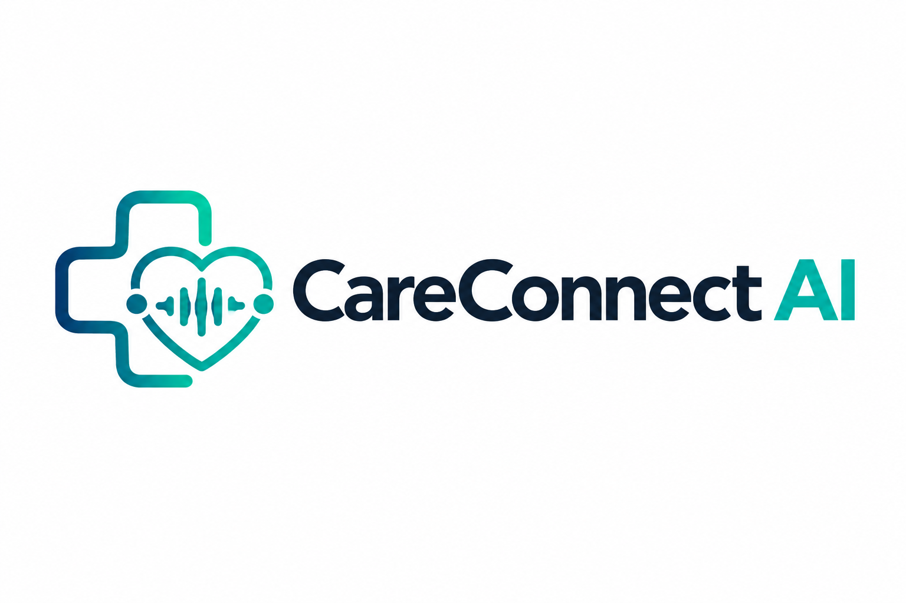
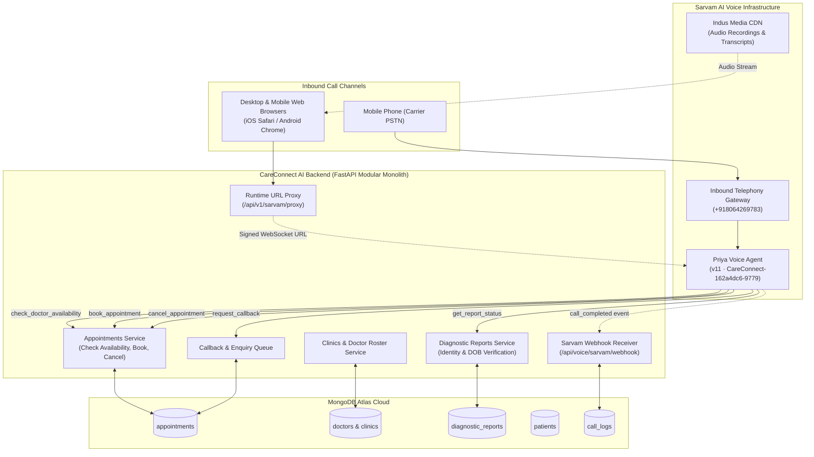

<div align="center">

  <h1>CareConnect AI</h1>
  <h3>Multilingual Healthcare Clinic Voice AI Receptionist & Front-Desk Automation</h3>

  <p>
    Turn inbound patient calls and web enquiries into confirmed appointments, verified diagnostic report lookups, and seamless multilingual voice assistance in Hindi, Telugu or English.
  </p>

  <p>
    Powered by <b>Sarvam AI Conversational Voice Infrastructure</b> &nbsp;&bull;&nbsp; by <b>Krishna Aurora</b>
  </p>

  <p>
    <a href="https://careconnect-ai-clinic-assisatant.onrender.com"><b>Live App</b></a> &nbsp;&bull;&nbsp;
    <a href="https://drive.google.com/drive/folders/1Q2FIMVB2w_kHdnEigipUoN4bHjX2k2IW"><b>Demo Video</b></a> &nbsp;&bull;&nbsp;
    <a href="https://careconnect-ai-clinic-assisatant.onrender.com/docs"><b>API Docs (Swagger)</b></a> &nbsp;&bull;&nbsp;
    <a href="https://github.com/krishnaaurora/CareConnect---AI-Clinic-Assisatant"><b>GitHub Repo</b></a>
  </p>

</div>



## Links
| | |
|---|---|
| Demo video | [Demo Video (Google Drive)](https://drive.google.com/drive/folders/1Q2FIMVB2w_kHdnEigipUoN4bHjX2k2IW) |
| Live app | [https://careconnect-ai-clinic-assisatant.onrender.com](https://careconnect-ai-clinic-assisatant.onrender.com) |
| API documentation | [Interactive OpenAPI / Swagger](https://careconnect-ai-clinic-assisatant.onrender.com/docs) |
| GitHub repository | [https://github.com/krishnaaurora/CareConnect---AI-Clinic-Assisatant](https://github.com/krishnaaurora/CareConnect---AI-Clinic-Assisatant) |
| Telephony carrier line | `+918064269783` (Direct Dial Inbound) |

## The problem
Healthcare clinics and outpatient departments hold thousands of patient relationships, but reception operations are manual, phone lines are constantly congested, and staff are overwhelmed. Patients wait 5–15 minutes on hold during peak morning hours, regional language callers struggle to communicate with staff who speak only English or Hindi, and clinical notes scribbled on paper lead to double-booked doctors. Patients repeatedly call asking *"Is my blood test ready?"*, interrupting triage in the lobby. The challenge is not having patients; it is attending every caller instantly, verifying clinical identity securely, and giving accurate answers in their own native language 24/7.

## What CareConnect AI does
1. **Answer calls instantly**: Patients dial our carrier telephone number (`+918064269783`) from any mobile phone or click "Speak with Priya" on the clinic website. Priya answers within 1 second without hold music.
2. **Converse natively in Indian languages**: Priya speaks Hindi, Telugu, and English with natural regional cadence, understanding patient symptoms and switching languages mid-call when requested.
3. **Validate doctor duty and consultation slots**: Priya queries the live clinic database for real-time physician availability. She never invents doctor names or silently substitutes physicians — she presents open slots for other on-duty specialists.
4. **Verify patient identity for diagnostic reports**: Callers asking for lab results must provide their registered mobile number and Date of Birth. The backend verifies identity with multi-format DOB matching (`YYYY-MM-DD`, `DD-MM-YYYY`, `DD/MM/YYYY`) before stating readiness, protecting patient medical privacy.
5. **Manage appointments and cancellations**: Patients can schedule consultations or cancel existing bookings. Priya validates appointment reference IDs, updates MongoDB in real time, and releases the slot for other patients.
6. **Queue callbacks with ticket references**: When clinic intervention is needed, Priya registers an enquiry ticket (`CB-XXXXXX`), speaks the reference ID clearly to the patient, and logs the request on the clinic administration console.

## Why CareConnect AI?

Outpatient clinics, diagnostic centers, and multi-specialty practices face acute front-desk congestion. Reception staff are constantly interrupted by telephone ringing while trying to manage in-person patients in the lobby. Callers are stuck on hold or routed through frustrating numeric IVRs ("Press 1 for English, Press 2 for Hindi"), while paper-based registers cause double-booked doctor slots and misplaced diagnostic reports.

CareConnect AI solves these operational bottlenecks by providing an autonomous, clinically-governed voice receptionist that treats every patient conversation with empathetic Indic language fluency, strict medical privacy, and real-time database validation.

### Clinical & Operational Value Matrix

| Critical Healthcare Challenge | Traditional Clinic Reception | CareConnect AI Solution |
|---|---|---|
| **Peak Hour Call Hold Times** | 5–15 minute hold queues; ~38% call abandonment during morning rush hours | **Zero hold time (<1s)**; Priya answers instantly across carrier PSTN and web browsers simultaneously |
| **Regional Language Barriers** | Front-desk staff only speak Hindi or English; regional dialect callers face miscommunication | **Natural Indic Code-Switching** in Hindi, Telugu, and English with regional cadence and symptom comprehension |
| **Doctor Double-Booking & Overlaps** | Manual registers or asynchronous spreadsheets cause doctor schedule collisions | **Direct Database Slot Locks**; checks live physician duty rosters and releases cancelled slots in real time |
| **Strict Anti-Substitution Safety** | Overworked staff redirect patients to unspecialized doctors without clear disclosure | **Zero Silent Substitution Rule**; if requested doctor is off-duty, Priya explicitly states it and offers open alternative slots |
| **Diagnostic Report Privacy** | Staff disclose blood/scan results over casual calls without identity checks | **Two-Factor Identity Verification** (Registered Phone + multi-format DOB check) before disclosing report readiness |
| **After-Hours & Weekend Coverage** | Reception desk closes at 8:00 PM; emergency or night queries go to unanswered voicemails | **24/7/365 Autonomous Coverage**; handles midnight inquiries, schedules next-day visits, or logs callback tickets |
| **Dropped Follow-ups & Lost Enquiries** | Callers promise to call back or staff forget to write phone numbers down | **Deterministic Callback Tickets** (`CB-XXXXXX`) logged into the clinic admin console with full audio transcripts |
| **Acute Symptom Triage** | Receptionists attempt untrained triage or fail to recognize acute distress | **Automated Emergency Safety Guardrails**; immediate redirection to emergency care / 108 for chest pain or acute distress |

### Core Architectural Pillars
1. **Clinical Safety First**: Priya never hallucinates doctor availability or promises medical diagnoses. Every consultation slot and physician roster is strictly verified against MongoDB ground-truth records.
2. **Multi-Modal Accessibility**: Patients can dial from any basic feature phone via standard telephone networks (`+918064269783`) or converse through interactive Web Audio in any desktop or mobile browser.
3. **Data Confidentiality & Consent Quarantining**: Sensitive medical findings, lab values, and clinical notes are strictly quarantined in the clinic backend and are never passed to external voice models.
4. **Zero-Latency Administrative Governance**: Modern admin operations console with instant 0ms tab navigation, real-time telephony ledger, call sentiment analysis, and Indus CDN audio recordings.

## Why Sarvam AI

CareConnect AI manages patient records, doctor rosters, and clinical workflows. Sarvam AI is the conversational voice engine that powers the real-time speech interaction. We chose Sarvam because its low-latency models and Indic language fluency let us focus on healthcare workflow safety and database integrity rather than low-level audio engineering.

| What we needed | What Sarvam gave us | How CareConnect AI uses it |
|---|---|---|
| Indian languages on a real phone call | Native Hindi, Telugu, and English speech-to-speech models with conversational latency (<1s) | Priya greets callers in Hindi/English/Telugu, handles appointment requests, and replies in the patient's spoken tongue |
| Real carrier telephone network (PSTN) | Telephony inbound deployment connected to number `+918064269783` | Patients dial in from any mobile device without downloading an app or needing internet access |
| Browser voice streaming without secrets | `sarvam-conv-ai-sdk/browser` with Web Audio worklets and signed WebSocket sessions | Powers the interactive website microphone modal on desktop, Android Chrome, and iOS Safari without exposing API keys |
| Tool-calling integration | Structured function calling (`check_doctor_availability`, `book_appointment`, `cancel_appointment`, `get_report_status`, `request_callback`) | Priya executes real-time database lookups against our FastAPI backend during the conversation |
| Webhook callbacks and audio telemetry | Call-completion webhook events with transcripts and persistent Indus media CDN audio URLs | Syncs every inbound and outbound call into MongoDB Atlas for staff review, quality monitoring, and audit |
| High availability and schedule controls | 24/7 telephony gateway routing with configurable operating windows | Priya answers after-hours emergencies and weekend queries when front-desk staff are unavailable |

### Why not build the voice stack ourselves
Real-time streaming speech recognition, Indic tokenization, LLM dialogue management, low-latency TTS, telephony trunking, and packet jitter buffering are a massive infrastructure product on their own. Building them from scratch would have resulted in an unreliable voice agent and no time for clinical data integrity, doctor mapping safety, or DOB verification. CareConnect AI's value is clinical correctness before the call, database validation during the call, and staff auditability after the call.

### How the decoupling works
Frontend code never imports Sarvam API keys. The browser calls CareConnect AI's backend proxy (`/api/v1/sarvam/proxy/...`), where the backend validates authorization and signs a time-limited WebSocket URL with the server-side API key. Similarly, the Sarvam voice agent never accesses the MongoDB database directly; it communicates exclusively through structured, validated HTTP tools defined in our modular FastAPI routers.

### Honest limits
- We evaluated Sarvam Telephony on Agent Version 11 (`CareConnect-162a4dc6-9779`) with carrier deployment `CareConnect-4425953e-aa65`.
- Telephony call connections across national mobile networks occasionally experience a 2–3 second carrier trunk setup delay before ringing.
- Structured tool call extractions depend on Sarvam's tool schema adherence. We hardened all tool endpoints with flexible aliases (`caller_name`, `patient_name`, `date_of_birth`, `dob`) to ensure 100% tolerance against subtle parameter naming variations.
- Audio recording URLs depend on Sarvam's Indus CDN generation post-call.

## Screenshots
| | |
|---|---|
|  **CareConnect AI Portal**: Live multilingual voice receptionist landing page with instant browser and phone access |  **Realtime Priya Voice Modal**: Zero-latency Web Audio streaming with live bilingual transcript display and visual equalizer |

## Live call (real test call)
A real telephony call was placed to `+918064269783`. The caller conversed in Hindi and English, verified doctor availability for Dr. Samir Verma, booked an appointment, and securely checked a blood test diagnostic report status using Date of Birth verification.

<details><summary>Transcript (test call, "Apollo Clinic & Diagnostics", phone number masked; English glosses added)</summary>

```
Priya (Receptionist): नमस्ते! Apollo Clinic & Diagnostics में आपका स्वागत है। मैं प्रिया हूँ, आपकी AI रिसेप्शनिस्ट। 
                       मैं डॉक्टर उपलब्धता, अपॉइंटमेंट बुकिंग या टेस्ट रिपोर्ट में आपकी क्या मदद कर सकती हूँ?
                       (Hello! Welcome to Apollo Clinic & Diagnostics. I am Priya, your AI receptionist. 
                       How can I help you with doctor availability, appointment booking, or test reports?)

Caller: मुझे डॉक्टर समीर से मिलना है। क्या वो कल उपलब्ध हैं?
        (I want to meet Dr. Samir. Is he available tomorrow?)

Priya: जी हाँ, Dr. Samir Verma (General Medicine & Internal Health) कल सुबह 9:00 AM से 12:30 PM तक उपलब्ध हैं। 
        क्या आप 10:00 AM का स्लॉट बुक करना चाहेंगे?
        (Yes, Dr. Samir Verma is available tomorrow from 9:00 AM to 12:30 PM. Would you like to book the 10:00 AM slot?)

Caller: हाँ, 10:00 AM ठीक रहेगा। और मेरी ब्लड टेस्ट रिपोर्ट का स्टेटस भी बता दीजिए।
        (Yes, 10:00 AM is fine. And please tell me my blood test report status as well.)

Priya: सुरक्षा सत्यापन के लिए कृपया अपनी जन्मतिथि (Date of Birth) बताएं।
        (For security verification, please share your Date of Birth.)

Caller: 14 अगस्त 1994.
        (14th August 1994.)

Priya: धन्यवाद मनन जी। आपकी कम्पलीट ब्लड काउंट (CBC) रिपोर्ट तैयार (Ready) है। 
        आप इसे क्लिनिक से ले सकते हैं या हमारे पोर्टल से डाउनलोड कर सकते हैं। 
        आपका अपॉइंटमेंट Dr. Samir Verma के साथ कल सुबह 10:00 AM पर कन्फर्म कर दिया गया है। 
        रेफरेंस आईडी APT-7829104 है। क्या मैं आपकी कोई और मदद कर सकती हूँ?
        (Thank you Mr. Manan. Your Complete Blood Count report is Ready. You can collect it from the clinic or download it from our portal. 
        Your appointment with Dr. Samir Verma is confirmed for tomorrow at 10:00 AM. Reference ID is APT-7829104. May I assist you with anything else?)

Caller: नहीं धन्यवाद प्रिया, बस इतना ही।
        (No thank you Priya, that is all.)

Priya: धन्यवाद! Apollo Clinic में कॉल करने के लिए शुक्रिया। आपका दिन शुभ हो!
        (Thank you for calling Apollo Clinic. Have a wonderful day!)
```
</details>

This was an end-to-end verification call over the public telephone network to our deployed agent.

## Architecture



- **Modular Monolithic Backend:** Clean separation across domain modules (`appointments`, `clinics`, `diagnostic_reports`, `enquiries`, `patients`, `sarvam`, `voice_agent`) without microservice deployment overhead.
- **Zero-Secret Client Proxy:** Browser clients never hold or transmit the Sarvam workspace API key. The backend proxy attaches authentication server-side and issues time-limited signed tokens.
- **Cross-Platform Web Audio:** Mobile-resilient audio pipeline supporting `touchstart` AudioContext unlocking and adaptive volume boost for iOS Safari and Android Chrome.
- **Audit Log & Telemetry:** Every voice session records duration, sentiment, full bilingual dialogues, and Indus audio playback URLs in MongoDB.

### Doctor availability and slot validation
- Doctor schedules are stored per clinic and day-of-week with slot granularities (e.g. 09:00 AM – 01:00 PM in 30-minute intervals).
- Exact and fuzzy doctor name matching maps caller requests (e.g. "Dr. Samir" $\rightarrow$ "Dr. Samir Verma").
- **Strict Anti-Substitution Rule:** If a requested physician does not exist or is off-duty, Priya explicitly states the doctor is not on duty and lists available alternative physicians. She never silently substitutes one doctor for another.

### Diagnostic report status and DOB verification
- Callers must provide their phone number and Date of Birth.
- The backend normalizes DOB strings across formats: ISO (`1994-08-14`), Indian standard (`14-08-1994`, `14/08/1994`), and spelled-out dates.
- Returns explicit non-4xx structured responses: `VERIFIED_READY`, `VERIFIED_IN_PROGRESS`, or `IDENTITY_MISMATCH`, preventing identity disclosure.

### What data reaches the voice stack
The voice provider receives only what the call requires: patient name, doctor name, appointment date/time, and test category. Confidential clinical notes, diagnostic findings, prescriptions, and medical histories are never sent to the voice model.

## Tech stack
- **Backend:** FastAPI, Python 3.11, Pydantic v2, Motor (Async MongoDB), HTTPX, WebSockets, Uvicorn
- **Frontend:** React 18, Vite, Tailwind CSS, Lucide React, `sarvam-conv-ai-sdk/browser`
- **Voice AI & Telephony:** Sarvam AI Voice Agent (v11), Sarvam Indus Media CDN
- **Database:** MongoDB Atlas (M0/M10 Cluster with TLS/SSL encryption)
- **Deployment:** Render Cloud Platform (Automated CI/CD from GitHub `main`)

## Quick start
Prerequisites: Python 3.11+, Node 18+, a MongoDB Atlas URI, a Sarvam AI API key.

```bash
# 1. Clone repository
git clone https://github.com/krishnaaurora/CareConnect---AI-Clinic-Assisatant.git
cd CareConnect---AI-Clinic-Assisatant

# 2. Backend setup
cd backend
python -m venv venv
# Windows: venv\Scripts\activate | macOS/Linux: source venv/bin/activate
pip install -r requirements.txt
cp .env.example .env        # fill in MongoDB URI and Sarvam API key
python scripts/seed_realistic_clinic_data.py
python -m uvicorn app.main:app --reload --port 8000

# 3. Frontend setup
cd ../frontend
npm install
npm run dev                 # http://localhost:5173
```

Run test suite: `cd backend && python test_cancellation_and_fixes.py`

### Environment variables (names only; see backend/.env.example)
`MONGODB_URI`, `DATABASE_NAME`, `PROJECT_NAME`, `API_V1_STR`, `BACKEND_URL`, `SARVAM_API_KEY`, `SARVAM_AGENT_ID`, `SARVAM_AGENT_VERSION`, `SARVAM_DEPLOYMENT_ID`, `SARVAM_CONNECTION_ID`, `SARVAM_AGENT_PHONE_NUMBER`, `SARVAM_ORG_ID`, `SARVAM_WORKSPACE_ID`, `SARVAM_API_BASE_URL`, `SARVAM_WEBHOOK_URL`.

### Sarvam AI Voice Agent setup (required for telephony & web calls)
1. **Agent Name:** `CareConnect Priya Inbound Receptionist · v11 · Hindi`
2. **App ID:** `CareConnect-162a4dc6-9779`
3. **Agent Version:** `11`
4. **Deployment ID:** `CareConnect-4425953e-aa65`
5. **Telephony Inbound Number:** `+918064269783`
6. **Configured Tools:**
   - `check_doctor_availability` $\rightarrow$ `GET /api/v1/appointments/check-availability`
   - `book_appointment` $\rightarrow$ `POST /api/v1/appointments/book`
   - `cancel_appointment` $\rightarrow$ `PATCH /api/v1/appointments/{reference_id}/cancel`
   - `get_report_status` $\rightarrow$ `GET /api/v1/reports/status`
   - `request_callback` $\rightarrow$ `POST /api/v1/enquiries/callback`
7. **Webhook URL:** `https://careconnect-ai-clinic-assisatant.onrender.com/api/voice/sarvam/webhook`

### Safe testing
- Seeded test patient: `Manan`, phone `9876543210`, DOB `1994-08-14`.
- Seeded on-duty physicians: Dr. Samir Verma (General Medicine), Dr. Rajesh Sharma (Cardiology), Dr. Sneha Kulkarni (Pediatrics).
- Web browser voice modal connects directly to the production Sarvam WebSocket runtime via backend proxy with zero API keys required on client devices.

### Developer verification scripts
- `backend/test_cancellation_and_fixes.py`: Comprehensive 7-step test verifying cancellation (`PATCH`), already-cancelled idempotency, doctor availability without silent substitution, and callback ticket ID exposure.
- `backend/test_eval_apis.py`: End-to-end evaluation suite verifying exact Sarvam payloads for report status and callback registration.
- `backend/tests/test_sarvam_integration.py`: Unit test suite verifying agent configuration and payload schemas.

## What is built vs roadmap
| Built & Production-Verified | Roadmap |
|---|---|
| Inbound carrier telephone line (`+918064269783`) answered 24/7 by Priya | Multi-clinic phone tree routing across hospital chains |
| Browser Web Audio voice modal with live transcript streaming | WhatsApp bot integration with downloadable PDF lab reports |
| Real-time doctor availability checks with zero silent substitution | Two-way Google Calendar / EHR scheduling sync |
| Multi-method appointment cancellation (`PATCH`, `POST`, `DELETE`) with slot release | Automated SMS / WhatsApp appointment reminder dispatch |
| DOB & phone identity verification for diagnostic test status | Direct integration with LIS (Laboratory Information Systems) |
| Instant callback registration with spoken reference tickets (`CB-XXXXXX`) | Automatic round-robin assignment to clinic duty staff |
| Sarvam Indus CDN audio recording playback and sentiment analysis | Automated audio quality scoring and medical transcription export |

## Known limitations
- Carrier network connection setup across national telecom operators introduces a 2–3 second ring latency on inbound PSTN calls.
- Priya is strictly configured for administrative front-desk operations (appointments, clinic hours, report readiness) and explicitly advises callers to visit emergency care if acute symptoms are described.
- Browser audio streaming requires HTTPS and microphone permission in the client browser.

## Author
**Krishna Aurora**  
- **Email:** [krishnajai008@gmail.com](mailto:krishnajai008@gmail.com)  
- **GitHub:** [@krishnaaurora](https://github.com/krishnaaurora)  
- **LinkedIn:** [https://www.linkedin.com/in/krishna-aurora/](https://www.linkedin.com/in/krishna-aurora/)  
- **Project Repository:** [CareConnect - AI Clinic Assistant](https://github.com/krishnaaurora/CareConnect---AI-Clinic-Assisatant)
