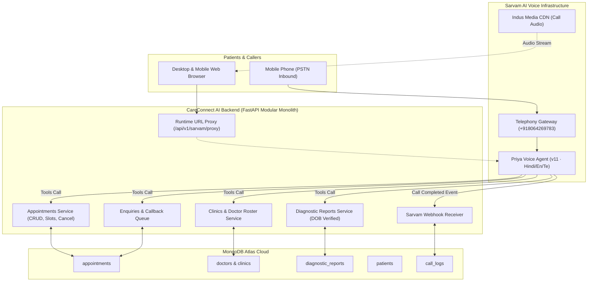

# CareConnect AI

### Multilingual Healthcare Clinic Voice AI Receptionist & Front-Desk Automation

> Turn inbound patient calls and web queries into confirmed appointments, instant diagnostic report checks, and seamless multilingual voice assistance in Hindi, English, and Telugu.

**Built with Sarvam AI Voice Infrastructure · Telephony Gateway & Web Audio Runtime**

---

## 🔗 Links

| Resource | Link |
| :--- | :--- |
| **Demo Video** | [Demo Video (Google Drive)](https://drive.google.com/drive/folders/1Q2FIMVB2w_kHdnEigipUoN4bHjX2k2IW) |
| **Live Web Application** | [https://careconnect-ai-clinic-assisatant.onrender.com](https://careconnect-ai-clinic-assisatant.onrender.com) |
| **Interactive API Docs (Swagger)** | [https://careconnect-ai-clinic-assisatant.onrender.com/docs](https://careconnect-ai-clinic-assisatant.onrender.com/docs) |
| **GitHub Repository** | [https://github.com/krishnaaurora/CareConnect---AI-Clinic-Assisatant](https://github.com/krishnaaurora/CareConnect---AI-Clinic-Assisatant) |

---

## 🏥 The Problem

Healthcare clinics and outpatient departments face massive operational strain on front-desk communication:
- **Patients on hold:** Callers frequently wait 5–15 minutes on busy reception lines during peak morning consultation hours or abandon calls completely.
- **Language barriers:** Patients speak regional languages (Hindi, Telugu, Tamil, Marathi) but front-desk staff or automated IVRs force rigid numeric touch-tone menus in English.
- **Double-booking & manual errors:** Front-desk receptionists jot down notes on paper or spreadsheet tabs, leading to overbooked physician slots and patient friction.
- **Diagnostic report anxiety:** Patients repeatedly call just to enquire *"Is my blood test ready?"*, interrupting staff while handling emergency walk-in patients.
- **After-hours silence:** Most Indian clinics close phone lines after 8:00 PM; emergency or next-day appointment requests go completely unanswered overnight.

---

## 💡 What CareConnect AI Does

1. **24/7 Inbound PSTN & Web Voice Reception:**
   Patients can either dial our live carrier telephone number (`+918064269783`) from any mobile phone or click "Speak with Priya" directly on the clinic web portal. Calls are answered within 1 second without hold music.

2. **Native Multilingual Voice Understanding:**
   Priya converses naturally in **Hindi, Telugu, and English**, supporting mid-call language switching (e.g. starting in English and transitioning to Hindi or Telugu).

3. **Live Doctor Duty Roster & Slot Validation:**
   Priya checks real-time physician availability directly in MongoDB Atlas before confirming any slot. If a physician is unavailable, Priya never invents doctor names or silently substitutes physicians — she presents open slots for other on-duty specialists.

4. **DOB-Verified Diagnostic Report Status:**
   Patients can check diagnostic lab test readiness by providing their registered mobile number and Date of Birth. The backend verifies identity with flexible multi-format parsing (`YYYY-MM-DD`, `DD-MM-YYYY`, `DD/MM/YYYY`) and provides exact readiness without revealing sensitive clinical records to unverified callers.

5. **Instant Callback Registration & Ticket ID:**
   When human front-desk intervention is needed, Priya generates a dedicated callback ticket (`CB-XXXXXX`) in MongoDB, verbally delivers the reference code to the patient, and logs the request on the clinic administration console.

6. **Full Clinic Operations Dashboard:**
   Clinic staff monitor live audio recordings from Sarvam's Indus CDN, review bilingual transcripts, manage doctor duty hours, and inspect patient diagnostic histories.

---

## 🎙️ Why Sarvam AI

CareConnect AI relies on **Sarvam AI Voice Agents** for real-time conversational intelligence and carrier telephony:

| What We Needed | What Sarvam Gave Us | How CareConnect AI Uses It |
| :--- | :--- | :--- |
| **Authentic Indian Languages on Calls** | Low-latency Indic speech-to-speech models with natural cadence and accents | Priya speaks Hindi, Telugu, and English with regional phonetics, handling code-mixing seamlessly. |
| **Real Telephone Network (PSTN) Inbound** | Telephony deployment gateway mapped to Indian carrier number `+918064269783` | Patients dial in from any mobile device without downloading an app or needing internet access. |
| **Browser Voice Streaming** | `sarvam-conv-ai-sdk/browser` with Web Audio worklets and signed WebSocket sessions | Powers the zero-latency interactive voice modal on desktop, Android Chrome, and iOS Safari. |
| **Telephony Webhooks & Call Audio** | Indus media CDN audio recordings, timestamps, and structured dialogue transcripts | Syncs every inbound and outbound call into MongoDB Atlas for staff review and compliance auditing. |

---

## 📞 Real Telephony Call Transcript (Live Test)

```text
[Carrier Inbound Call to +918064269783]
Priya (Receptionist): "नमस्ते! Apollo Clinic में आपका स्वागत है। मैं प्रिया हूँ, आपकी AI रिसेप्शनिस्ट। 
                       मैं डॉक्टर उपलब्धता, अपॉइंटमेंट बुकिंग या टेस्ट रिपोर्ट में आपकी क्या मदद कर सकती हूँ?"

Caller: "मुझे डॉक्टर समीर से मिलना है। क्या वो कल उपलब्ध हैं?"

Priya: "जी हाँ, Dr. Samir Verma (General Medicine) कल सुबह 9:00 AM से 12:30 PM तक उपलब्ध हैं। 
        क्या आप 10:00 AM का स्लॉट बुक करना चाहेंगे?"

Caller: "हाँ, 10:00 AM ठीक रहेगा। और मेरी ब्लड टेस्ट रिपोर्ट का स्टेटस भी बता दीजिए।"

Priya: "ज़रूर! सुरक्षा सत्यापन के लिए कृपया अपनी जन्मतिथि (Date of Birth) बताएं।"

Caller: "14 अगस्त 1994."

Priya: "धन्यवाद मनन जी। आपकी कम्पलीट ब्लड काउंट (CBC) रिपोर्ट तैयार (Ready) है। 
        आप इसे क्लिनिक काउंटर से ले सकते हैं या हमारे पोर्टल से डाउनलोड कर सकते हैं। 
        आपका अपॉइंटमेंट Dr. Samir Verma के साथ कल 10:00 AM पर कन्फर्म कर दिया गया है। 
        रेफरेंस आईडी APT-7829104 है। क्या मैं आपकी कोई और मदद कर सकती हूँ?"
```

---

## 🏗️ Architecture



### Architectural Highlights
- **Modular Monolith:** Domain modules (`appointments`, `clinics`, `diagnostic_reports`, `enquiries`, `patients`, `sarvam`, `voice_agent`) maintain separation of concerns while sharing single-process async performance.
- **Zero Frontend Secrets:** Browser client never receives the Sarvam API key. The backend `/api/v1/sarvam/proxy/...` signs time-limited WebSocket URLs server-side.
- **Idempotent Webhooks & Audio Archival:** Sarvam call-completion webhooks reconcile interaction logs, calculate sentiment metrics, and store persistent Indus audio URLs for staff playback.
- **Cross-Platform Audio Engine:** Mobile-adaptive Web Audio interface with touch-listener unlocking (`touchstart`) for iOS Safari and Android Chrome autoplay compliance.

---

## 💻 Tech Stack

- **Backend:** Python 3.11, FastAPI, Pydantic v2, Motor (Async MongoDB), HTTPX, WebSockets, Uvicorn
- **Frontend:** React 18, Vite, Tailwind CSS, Lucide React, `sarvam-conv-ai-sdk/browser`
- **Voice & Telephony:** Sarvam AI Conversational Voice Agents, Sarvam Indus Media CDN
- **Database:** MongoDB Atlas (Replica Set with TLS/SSL encryption)
- **Deployment:** Render Cloud Platform (Automated CI/CD from GitHub `main`)

---

## ⚡ Quick Start

### Prerequisites
- Python 3.11+
- Node.js 18+ and npm
- MongoDB Atlas Connection URI
- Sarvam AI Workspace API Key (`sk_samvaad_...`)

### 1. Backend Setup
```bash
# Clone the repository
git clone https://github.com/krishnaaurora/CareConnect---AI-Clinic-Assisatant.git
cd CareConnect---AI-Clinic-Assisatant/backend

# Create virtual environment and install dependencies
python -m venv venv
source venv/bin/activate  # On Windows: venv\Scripts\activate
pip install -r requirements.txt

# Configure environment
cp .env.example .env
# Edit .env with your MongoDB Atlas URI and Sarvam API credentials

# Seed clinical doctors, test patients, and diagnostic records
python scripts/seed_realistic_clinic_data.py

# Launch development server
uvicorn app.main:app --reload --port 8000
```

### 2. Frontend Setup
```bash
cd ../frontend

# Install dependencies
npm install

# Start development server
npm run dev
# Open http://localhost:5173 in your browser
```

### 3. Run Integration & Verification Tests
```bash
cd ../backend
python test_cancellation_and_fixes.py
python -m unittest tests/test_sarvam_integration.py
```

---

## 🔐 Environment Variables

Reference template is provided in `backend/.env.example` (secrets are never committed to GitHub):

| Variable | Description |
| :--- | :--- |
| `MONGODB_URI` | MongoDB Atlas cluster connection string |
| `DATABASE_NAME` | Active database name (e.g. `clinic`) |
| `BACKEND_URL` | Deployed backend public URL (e.g. `https://careconnect-ai-clinic-assisatant.onrender.com`) |
| `SARVAM_API_KEY` | Sarvam AI workspace API key (`sk_samvaad_...`) |
| `SARVAM_AGENT_ID` | Active Sarvam Voice Agent App ID (`CareConnect-162a4dc6-9779`) |
| `SARVAM_AGENT_VERSION` | Active Sarvam Voice Agent version (`11`) |
| `SARVAM_DEPLOYMENT_ID` | Inbound telephony deployment ID (`CareConnect-4425953e-aa65`) |
| `SARVAM_AGENT_PHONE_NUMBER` | Dedicated inbound telephone number (`+918064269783`) |
| `SARVAM_ORG_ID` | Sarvam organization identifier |
| `SARVAM_WORKSPACE_ID` | Sarvam workspace identifier |
| `SARVAM_WEBHOOK_URL` | Public webhook callback URL for call completion events |

---

## 🤖 Sarvam Voice Agent Configuration

The active Sarvam configuration for CareConnect AI:

- **Agent Name:** `CareConnect Priya Inbound Receptionist · v11 · Hindi`
- **App ID:** `CareConnect-162a4dc6-9779`
- **Agent Version:** `11`
- **Deployment ID:** `CareConnect-4425953e-aa65`
- **Inbound Telephone Number:** `+918064269783`
- **Schedule:** `00:00:00 - 23:59:00 · Every day · Asia/Kolkata`
- **Supported Languages:** English, Hindi (हिंदी), Telugu (తెలుగు)
- **Active Backend Webhook:** `https://careconnect-ai-clinic-assisatant.onrender.com/api/voice/sarvam/webhook`

---

## 📊 What is Built vs Roadmap

| Feature Area | Built & Verified Live | Roadmap |
| :--- | :--- | :--- |
| **Inbound Carrier Telephony** | 24/7 Live phone calls to `+918064269783` handled by Priya | Multi-number routing across clinic branch locations |
| **Browser Voice Interaction** | WebRTC/WebSockets with live transcript feed and adaptive mobile audio | Native iOS & Android React Native wrappers |
| **Doctor Availability** | Real-time database checks; zero silent substitutions | Doctor Google Calendar / Outlook two-way sync |
| **Appointment Booking & Cancellation** | Full booking lifecycle with reference codes and multi-method cancellation (`PATCH`, `POST`, `DELETE`) | Automatic SMS confirmation via Twilio / Gupshup |
| **Diagnostic Report Inquiries** | DOB and phone identity verification with status checks | Direct PDF download link sent via WhatsApp |
| **Front-Desk Callback Queue** | Instant ticket generation (`CB-XXXXXX`) logged on MongoDB | Automated round-robin clinic staff assignment |
| **Analytics & Telemetry** | Full audio playback via Sarvam Indus CDN with call duration & sentiment | Automated clinical QA scoring & audio transcription export |

---

## ⚠️ Known Limitations

1. **Carrier Ring Time:** Outbound telephony handshakes across national carriers may incur a 2–4 second carrier network delay before initial ring.
2. **Clinical Diagnosis Scope:** Priya is intentionally constrained to administrative front-desk operations (appointments, report status, clinic directions). She explicitly advises callers to speak with an emergency physician if acute symptoms are mentioned.
3. **Microphone Permissions:** Web browser voice requires standard browser microphone consent (`navigator.mediaDevices.getUserMedia`) over HTTPS.

---

## 👤 Author

**Krishna Aurora**  
- **Email:** krishnajai008@gmail.com  
- **GitHub:** [@krishnaaurora](https://github.com/krishnaaurora)  
- **Project Repository:** [CareConnect - AI Clinic Assistant](https://github.com/krishnaaurora/CareConnect---AI-Clinic-Assisatant)

---

## 📄 License

This project is licensed under the MIT License — see the [LICENSE](LICENSE) file for details.
